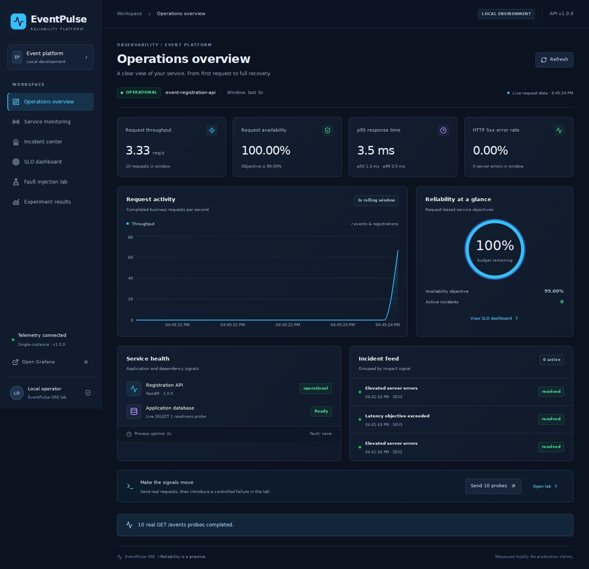
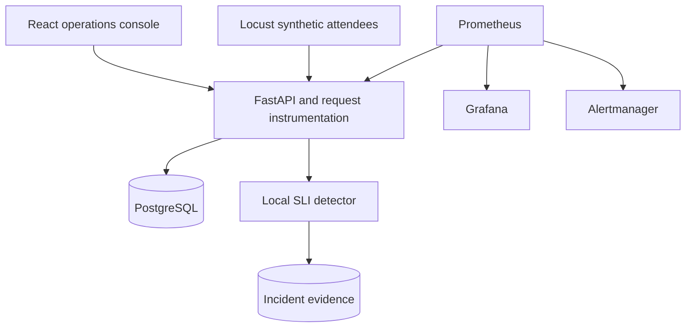

# EventPulse SRE
### Event platform reliability & observability command center

A local-first SRE portfolio project: register synthetic attendees, observe request SLIs, introduce controlled failures, investigate incidents and verify recovery. Built for a final-year software engineering portfolio and Cvent SRE interview discussions. This is an educational MVP, not a production-ready service.



## v2 engineering upgrade (17 October 2026)

Current audit, statuses and reproduction steps: [docs/AUDIT_V2.md](docs/AUDIT_V2.md), [docs/VERIFICATION_REPORT.md](docs/VERIFICATION_REPORT.md), [CHANGELOG_V2.md](CHANGELOG_V2.md). Original evidence and POSTMORTEM.md are preserved; dated root test/publication reports describe the earlier build, not the current repository status.

New: Linux Bash automation, 15 Grafana panels, sparse-error/no-traffic PromQL fixes, full-stack CI integration and timestamped Docker crash/manual-outage measurement. AWS is prepared only; **no cloud deployment is claimed**. Docker restart policies do not restart merely unhealthy containers. In-place deployment is not a zero-downtime rollout.

Operations: [runbook](docs/SRE_RUNBOOK.md), [SLIs/SLOs](docs/SLO_DEFINITIONS.md), [CI/CD](docs/CI_CD.md), [experiments](docs/FAULT_INJECTION.md), [AWS preparation](docs/AWS_DEPLOYMENT.md), [measurement report](docs/PERFORMANCE_REPORT.md), [architecture](docs/ARCHITECTURE.md). Use [RESUME_EVIDENCE_V2.md](RESUME_EVIDENCE_V2.md) for current evidence-qualified bullets. The existing frontend remains intact.

```powershell
python scripts/bootstrap.py
$env:COMPOSE_PROJECT_NAME = 'eventpulse-v2-demo'
docker compose config --quiet
docker compose up --build -d --wait --wait-timeout 180
# Run Bash operations under WSL, or use the existing native Windows setup below.
wsl bash -lc 'cd /mnt/d/YOUR_PROJECT_PATH && bash scripts/verify-stack.sh'
```

Use your actual extracted/cloned path under WSL; the path above is a placeholder. For a native Windows real-Docker experiment, from the repository root after dependencies are installed:

```powershell
python -m pip install -r backend/requirements-dev.txt
$env:ENABLE_PROCESS_CRASH_TEST = 'true'
docker compose up -d --force-recreate --wait api
# Wait >10 seconds before testing process recovery.
python scripts/reliability.py --scenario api-crash --project eventpulse-v2-demo --allow-local-faults
```

The project must be disposable and have run for >10 seconds first. Output is new timestamped evidence under evidence/v2. No AWS account details are required to run locally.

## Start here

Requirements: Docker Desktop with Compose v2 (Windows: WSL2 engine), or Python 3.12+ and Node 22+ for the native lab.

```powershell
python scripts/bootstrap.py
docker compose up --build -d
```

Open dashboard http://localhost:8080, API docs http://localhost:8000/docs, Prometheus http://localhost:9090, Alertmanager http://localhost:9093, Grafana http://localhost:3000 (admin; generated GRAFANA_PASSWORD in local .env). All published ports bind to loopback. Initial SLI values are unknown until business traffic arrives. Click **Send 10 probes** to collect actual requests.

The default Compose stack uses PostgreSQL. Fault injection stays disabled and the web proxy blocks fault mutations. Use the native local lab below for experiments. No paid accounts or external services are required. Typography uses local system fallbacks.

## Native API and console

From the repository root:

```powershell
python -m venv .venv
.venv\Scripts\Activate.ps1
python -m pip install -r backend/requirements-dev.txt
cd backend
python -m uvicorn app.server:app --host 127.0.0.1 --port 8000
```

In a second terminal:

```powershell
cd frontend
npm ci
npm run dev
```

Open http://127.0.0.1:5173. Native mode defaults to a local SQLite file for a dependency-light demonstration. To use PostgreSQL, start `docker compose up -d db` and set `DATABASE_URL` before starting the API; see SETUP_WINDOWS.md. SQLite checks do not prove PostgreSQL integration.

## Architecture



Two deliberately separate detectors: the console reads exact rolling request samples and local incident records; Prometheus evaluates longer-window alert rules and Alertmanager groups those alerts. Prometheus alerts do not automatically appear in Incident Center. The UI explicitly labels that separation.

## What is included

- FastAPI, SQLAlchemy, Pydantic, PostgreSQL, Pytest; conditional capacity updates and idempotency protection.
- Prometheus counters, latency histogram, database gauge, in-flight gauge, process metrics, uptime and version; JSON request logs and bounded correlation IDs.
- React, TypeScript, Vite, Tailwind CSS, Recharts and Lucide; six responsive operations pages with loading, error and no-data states.
- SLO math, multiwindow burn alert, alert grouping, persisted incident timelines and local token-protected investigation notes.
- Local-only fault lab, TTL-limited simulations, Locust workload, reproducible labeled HTTP experiments, CSV/JSON exports and CI configuration.

## Verify

```powershell
cd backend
python -m ruff check app tests ../scripts
python -m pytest -q --junitxml=../evidence/backend-junit.xml
cd ../frontend
npm ci
npm test
npm run build
npx playwright install chromium
# Keep the API running in another terminal.
npm run test:e2e
```

The PostgreSQL integration check runs only when `PG_TEST_URL` points to a **dedicated test database**. It truncates registration and incident tables; do not use a shared database. CI provisions its own PostgreSQL service. A configured workflow is not evidence of a successful remote CI run.

## Reproduce incidents and load

See [FAULT_INJECTION.md](FAULT_INJECTION.md) for the local opt-in, then:

```powershell
python scripts/evaluate.py
python -m locust -f scripts/locustfile.py --host http://127.0.0.1:8000 --headless -u 10 -r 2 -t 30s --csv evidence/locust
```

`evaluate.py` expects a fresh native lab with a 3-second observation window; default operations use 60 seconds. It runs predefined development and held-out scenarios with independent truth labels. See [EVALUATION.md](EVALUATION.md) and the exported evidence. Existing experiment data is labeled as historical evidence; it is not live traffic. For unattended local verification, `python scripts/verify_local.py` launches its own SQLite API and Vite, evaluates HTTP scenarios, runs browser tests, then stops both services. Install browser dependencies first.

## Signals and semantics

Example **metric names**, not measured values:

```promql
sum(rate(eventpulse_http_requests_total{route=~"/events|/registrations.*"}[5m]))
histogram_quantile(0.95, sum by (le) (rate(eventpulse_http_duration_seconds_bucket{route=~"/events|/registrations.*"}[5m])))
eventpulse_database_ready
eventpulse_registrations_total
```

Availability is the fraction of business responses below HTTP 500 (4xx is excluded from server error counts but is still a response). The 99% availability objective and 95% of responses within 500ms are educational targets, not Cvent policies. Budget may be negative. No traffic means unknown, never 100%. Measurement is request-based and cannot see downtime without incoming requests; external probing is a future extension.

## Verified local results

| Check | Result |
|---|---|
| Backend / frontend / browser | 34 passed + 1 skipped / 3 passed / 2 passed |
| HTTP scenarios | 12 completed; 6 held-out |
| Impact detection / false alerts | 8 of 8 / 0 in 4 baseline-noise scenarios |
| Fault-window requests | 3,060 |
| PostgreSQL, Docker runtime, remote CI | Pending verification |

## Evidence and limitations

[TEST_RESULTS.md](TEST_RESULTS.md) records actual verification and blockers. Raw JUnit, HTTP scenario measurements and UI captures are under `evidence/` and `docs/screenshots/`. [RESUME_EVIDENCE.md](RESUME_EVIDENCE.md) includes exactly three defensible resume bullets, a 60-second explanation and interview questions.

Local SLIs are per-process, in-memory and reset on restart; one API worker is required. Incident records are persisted but require the application database. Incidents cannot be persisted during a real database outage; the independent Prometheus target probe still provides out-of-process visibility. The database fault button simulates request failures; it does not stop PostgreSQL. No distributed tracing is claimed: request correlation is implemented, OpenTelemetry spans are deferred. Authentication for a multi-user deployment, migrations, durable telemetry aggregation, external notification delivery and long-running reliability studies are out of scope. Grafana/Prometheus container execution and remote CI require separate verification where unavailable here.

## Project map

`backend/app/` API, database and telemetry; `frontend/src/` console; `monitoring/` Prometheus, Grafana, Alertmanager; `scripts/` bootstrap, load and evaluation; `evidence/` measured results; `.github/workflows/ci.yml` checks.

MIT licensed. Synthetic data only. Intended GitHub URL: https://github.com/yusufthecoder474/EventPulse-SRE (publication status: TEST_RESULTS.md).
