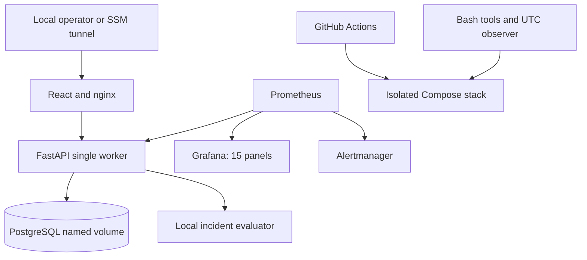

# v2 architecture

The original application and APIs remain intact. See the original root ARCHITECTURE.md for business transactions and single-worker telemetry details.

The UTC observer lives outside the API and can observe its process death. The application incident evaluator still depends on the application database and cannot persist incidents through a real DB outage. The two systems are intentionally separate.

Every service has Docker `restart: unless-stopped`; the API allows 20 seconds for graceful termination. Health checks signal readiness, not restart instructions. An unhealthy API with a running process is not restarted automatically. A manually stopped dependency stays stopped until explicitly started. Database recovery in the manual experiment means restarting PostgreSQL and observing SQLAlchemy reconnect, not reconstructing lost data.

Cloud preparation reuses this stack on one EC2 host. The template has no inbound security-group rules; all Compose published ports bind to loopback. Access uses SSM port forwarding. This is a single-host educational demo, not a highly available architecture. AWS resources have not been created by this work.
