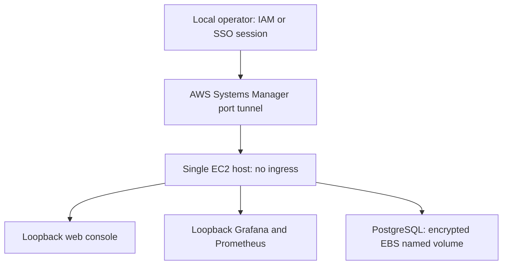

# Optional AWS deployment — NOT VERIFIED

No AWS resources have been created and no cloud credentials are needed for this preparation. Actual resource creation requires separate explicit approval. Never send root passwords, MFA codes, access keys, secret keys or private keys in chat. Use local short-lived IAM/SSO sessions; the host uses an IAM instance profile, not embedded AWS keys.

## Proposed limited demonstration

One Amazon Linux 2023 x86 EC2 instance, Docker Compose, encrypted 30GiB gp3 EBS, an IAM role with AmazonSSMManagedInstanceCore and a security group with **no inbound rules**. Candidate region ap-south-1 (Mumbai) for an India-based educational demo, subject to your approval and current price/capacity. Template default t3.medium (4GiB) supports six containers more comfortably than micro instances; t3.small may be memory-constrained. This is not Free Tier advice or an HA deployment.



No public app endpoint is required. Security group ingress: none (not even 22/80/443/5432/3000/9090). Outbound access must reach SSM, container registries, package repositories and source repository. A private subnet requires an existing connectivity plan; this template creates **no NAT gateway, internet gateway or paid VPC endpoints**. A public subnet option requires an internet gateway route and explicit approval for a public IPv4 address; even then inbound ports remain closed. Outbound rules are broad for this educational bootstrap and should be narrowed for a managed deployment.

## Approval information needed before deployment

Confirm region, account/profile on your own machine (no secret values), allowed EC2 type, 30GiB disk, subnet/VPC connectivity, whether public IPv4 is allowed, maximum demo duration, estimated budget and who will run teardown. Review current prices in AWS Pricing Calculator. A budget alert is not a hard spending cap. We will not request credentials or run resource creation until you explicitly approve a concrete resource and cost plan.

Costs may include EC2 runtime and burst credits, EBS even while stopped, public IPv4, data transfer, snapshots, logs and any existing NAT/endpoints used. No current numeric cost estimate is asserted; confirm region-specific prices immediately before approval. Do not assume Free Tier eligibility. Stopping an instance does not delete its volumes or all related charges.

## Reviewable configuration

`deploy/aws/ec2-demo.yml` is a CloudFormation template for an existing VPC/subnet. It requires IMDSv2 and encrypted EBS and attaches the SSM role. The default does not assign public IPv4; you must supply working outbound connectivity. Template syntax/security properties are checked locally; actual CloudFormation validation and launch remain NOT VERIFIED.

After approval, run locally with your authenticated AWS profile:

```powershell
aws sts get-caller-identity --profile YOUR_PROFILE
aws cloudformation validate-template --template-body file://deploy/aws/ec2-demo.yml --region ap-south-1 --profile YOUR_PROFILE
# The following CREATES BILLABLE RESOURCES: run only after approval.
aws cloudformation deploy --stack-name eventpulse-sre-demo --template-file deploy/aws/ec2-demo.yml --parameter-overrides VpcId=vpc-YOUR_ID SubnetId=subnet-YOUR_ID InstanceType=t3.medium AssociatePublicIp=false --capabilities CAPABILITY_IAM --region ap-south-1 --profile YOUR_PROFILE
aws cloudformation describe-stacks --stack-name eventpulse-sre-demo --region ap-south-1 --profile YOUR_PROFILE
```

The deploy command does not create network connectivity. Confirm the subnet plan before executing it. In SSM, manually run the reviewed `deploy/aws/setup-host.sh` with `EC2_SETUP_APPROVED=yes`; install Compose v2 following official Docker instructions, verify its checksum, and confirm `docker compose version`. Clone the public repository, check out a reviewed full SHA, generate local .env, then invoke the in-place deployment script as the Docker-authorized host user. Do not copy a local .env or personal keys into GitHub.

From your local machine, tunnel web access:

```powershell
aws ssm start-session --target i-YOUR_INSTANCE --document-name AWS-StartPortForwardingSession --parameters 'portNumber=["8080"],localPortNumber=["8080"]' --region ap-south-1 --profile YOUR_PROFILE
```

Requires AWS CLI, Session Manager plugin, SSM Agent, instance role and operator permissions. Open http://localhost:8080. Use separate tunnels for admin tools only as needed. Grafana still requires its generated local admin password.

## Verification checklist

Confirm correct account/region and approved resource IDs; SSM connection succeeds; no security-group ingress; no public DB/admin listeners; all six services run; readiness + smoke pass; synthetic registration persists across API recreation; Prometheus scrapes + alert rules healthy; Grafana panels show actual traffic; fault injection disabled; no secrets committed; measured results recorded separately under evidence/v2/aws. Run `verify-stack.sh` on the host. Only then add a narrowly scoped AWS deployment claim to a resume.

## Teardown after the approved demo

Export any required synthetic evidence safely. `docker compose down` stops application containers but does NOT terminate EC2. Then run `aws cloudformation delete-stack --stack-name eventpulse-sre-demo --region ap-south-1 --profile YOUR_PROFILE` and `aws cloudformation wait stack-delete-complete ...` with the same stack/region/profile. The template root EBS has DeleteOnTermination=true. Verify the instance is terminated, associated volumes/addresses are released, and any separately created snapshots, logs, NAT gateways or endpoints are removed if appropriate. Review billing afterward.

Primary references: https://docs.aws.amazon.com/AWSEC2/latest/UserGuide/connect.html ; https://docs.aws.amazon.com/systems-manager/latest/userguide/session-manager-working-with-sessions-start.html ; https://calculator.aws/ .
