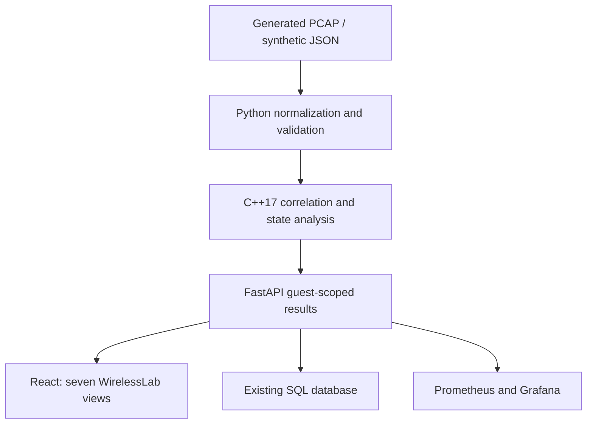

# WirelessLab architecture

> Initial WirelessLab release guide retained as historical context. For current V3 import/handshake/test-plan capabilities and boundaries, see [V3 architecture](wirelesslab-v3/ARCHITECTURE.md) and [V3 results](wirelesslab-v3/TEST_RESULTS.md). The legacy operator-only `/uploads` remains restricted; V3 adds a separate consent-bound `/imports` endpoint.

WirelessLab extends EventPulse-SRE on `feat/wirelesslab-offline`. The supplied archive and main commit `e2538f446c9b734e8fa2803ed5cc9da059f57cc6` have identical source trees. Existing FastAPI registration, capacity, fault, telemetry and experiment APIs remain in place. React keeps its six original pages, and Prometheus/Grafana retain the original dashboard and alerts. PostgreSQL/SQLite and SQLAlchemy are reused; no broker or extra database is introduced. Historical evidence hashes are in `wireless-lab/evidence/baseline-preservation.json`.

## Ownership and boundaries

| Component | Responsibility | Boundary |
|---|---|---|
| `wireless-lab/scripts/generate_fixtures.py` | Deterministic stdlib PCAP/JSON generator | Fixed synthetic identities and timestamps; never opens network interfaces |
| `python/wirelesslab/packets.py` | TShark file extraction, timestamp normalization, pseudonyms | 1 MiB / 5000 packets; no decryption or capture |
| `python/wirelesslab/schema.py` | Typed event validation and explanations | Unknown fields rejected; status consistency checked |
| `cpp/analyzer.cpp` | Sort, deduplicate, correlate per client/AP, classify | 50,000 events, configurable 500–60,000 ms correlation window through Python |
| `python/wirelesslab/analyze.py` | Validated TSV bridge and bounded subprocess | Eight-second timeout; C++ JSON contract version 1 |
| `python/wirelesslab/scenarios.py` | Approved fixture lookup, expected/actual assertions | Only A–J registry IDs; never accepts filesystem paths |
| `backend/app/wireless_api.py` | Session ownership, quotas, storage, exports, audit, metrics | New tables in existing database; guest cannot upload |
| `frontend/src/WirelessLab.tsx` | Seven interactive views | Actual API outputs; all inventory visibly simulated |

## Event contract

JSON contains `event_id`, integer `timestamp_us`, `client`, `ap`, `kind`; optional `code`/`sequence` default -1 (unknown), `origin`, `direction`, `reported_state`, `ssid`, `frame_subtype`, `link_layer`, `missing_fields`, and original decimal `capture_timestamp`. Integer microseconds truncate sub-microsecond precision; original decimal text remains available. Safe identifiers are 1–80 ASCII-like alphanumeric/underscore/dot/colon/hyphen characters. Pydantic's complete source is authoritative. Examples live in `fixtures/*.json`.

The internal UTF-8 TSV has exactly ten columns, no header: event_id, timestamp_us, client, ap, kind, code, sequence, origin, direction, reported_state. Each line is <=1024 bytes. SSIDs and packet metadata stay in Python and never enter C++ text fields. C++ checks field counts, numeric bounds, identifiers and enumerations and returns generic errors with a nonzero exit status. The Python boundary additionally rejects contradictory success/rejection codes.

`Analyzer` encapsulates the analysis window and owns no global state. `std::vector<Event>` owns records; stable sorting restores time order, a `std::set<std::tuple<...>>` detects semantic duplicates, and `std::map` provides deterministic per-client/AP ordering. Streams, strings and containers release memory through RAII. No manual allocation, copied VitalWatch code, driver, firmware or radio integration is present.

## Interpretation

Association latency is matched request-to-response, not total join latency. Default threshold is 500 ms and correlation window 5000 ms; these are lab choices, not IEEE limits. Missing packet context reports incomplete evidence; synthetic impossible transitions also flag `invalid_transition`. Explicit failures take priority over success. Findings aggregate across the trace; this is a compact per-pair model, not a complete multi-session reconstruction or retransmission-aware protocol implementation. EAPOL message sets are observations, not proof of ordering, MIC validity or working encryption. Controller timestamps assume a shared clock.

Metrics use finite scenario/verdict labels. A separate `wirelesslab.json` Grafana dashboard adds run counts, analysis-request p95 and event count. It is included in the existing provisioning path. No production configuration was applied.
