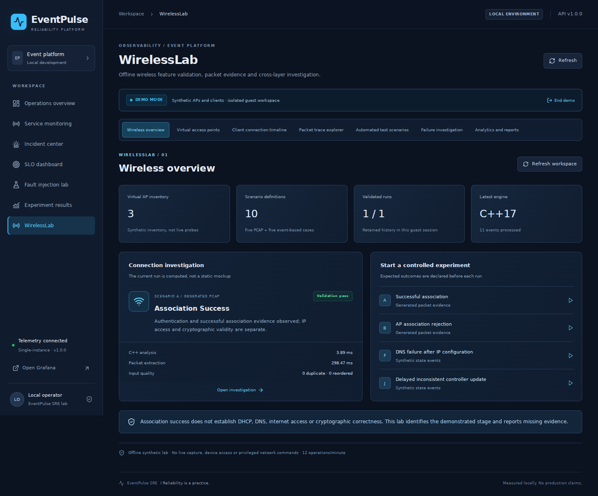
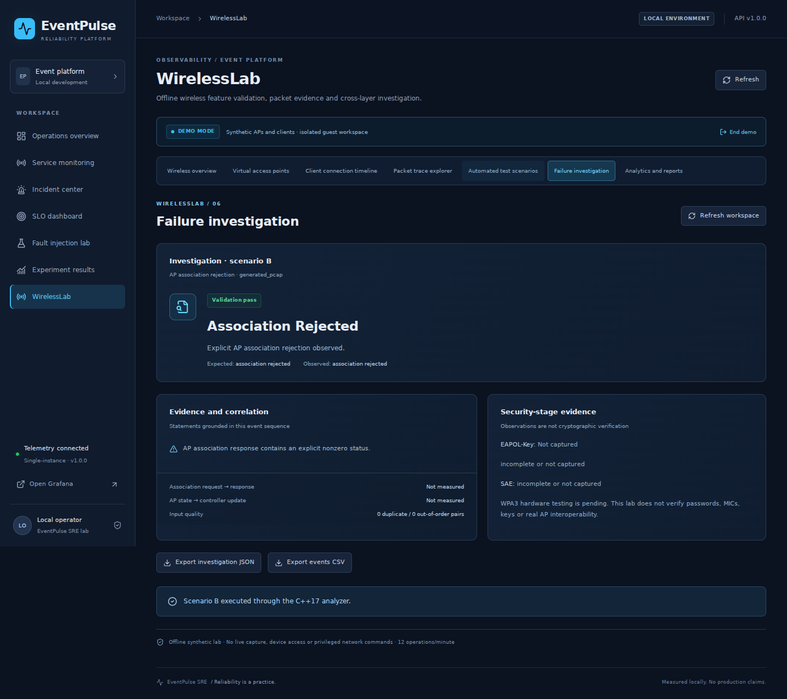
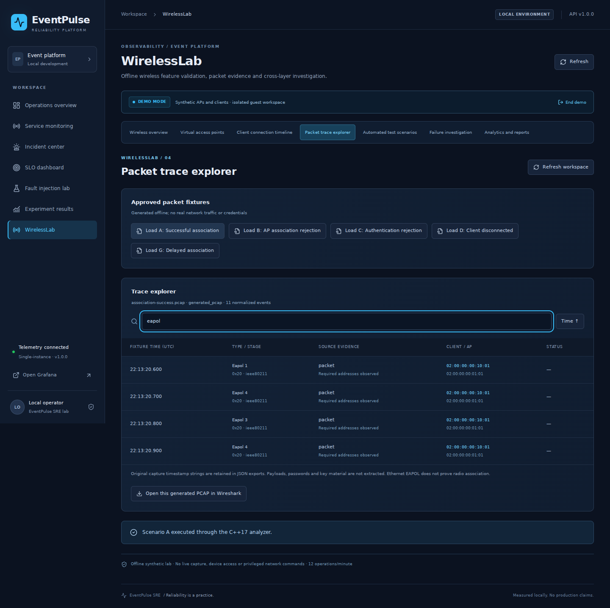
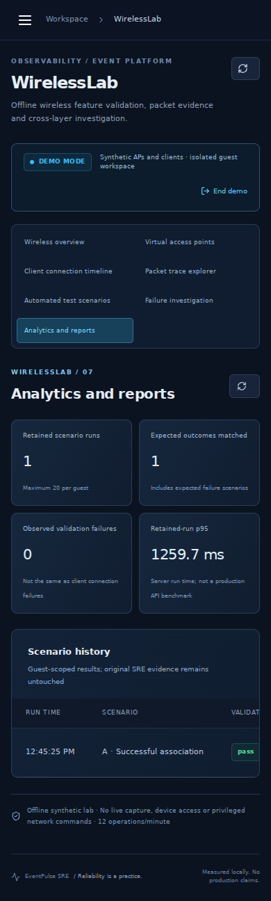

# WirelessLab measured results

Evidence date: 2026-10-19. All wireless inputs are generated synthetic fixtures; results are development measurements, not hardware or production reliability claims.

| Check | Actual local outcome | Evidence |
|---|---|---|
| C++17 CTest | 21 passed | `wireless-lab/evidence/cpp-junit.xml` |
| Original backend + wireless Python/API | 83 passed, 1 PostgreSQL test skipped | `wireless-lab/evidence/python-api-junit.xml`, `python-api-output.txt` |
| Original frontend unit tests | 3 passed | `wireless-lab/evidence/frontend-output.txt` |
| TypeScript and production Vite build | Passed | `wireless-lab/evidence/frontend-build.txt` |
| Real browser flows | 4 passed: 2 original + 2 wireless | `wireless-lab/evidence/browser-junit.xml`, `browser-output.txt` |
| Scenarios A–J | 10 executed, 10 matched expected outcomes, 0 mismatches | `wireless-lab/evidence/scenarios-20261019T093300Z.json` |
| Original historical artifact preservation | All recorded hashes unchanged | `wireless-lab/evidence/baseline-preservation.json` |
| Hardware / virtual radio / real SAE integration | Not run | `docs/LINUX_LAB_SETUP.md`, `WPA2_WPA3.md` |

Original historical claims of 50 backend, three frontend and two browser tests were treated as a baseline, then rerun after integration. The local PostgreSQL-only skip is explicit; GitHub Actions provides PostgreSQL for that regression test. Docker is unavailable in the local container, so full Compose/monitoring/crash recovery verification depends on the real CI run; no local Docker success is claimed.

## Performance

Source: `wireless-lab/evidence/performance-20261019.json`; reproduction: `python wireless-lab/scripts/evaluate.py --output wireless-lab/evidence/performance-new.json`. Environment: Linux 6.18.55 x86_64/glibc 2.39, Python 3.12.14, g++ 13.3, TShark 4.2.2, Intel Xeon Platinum 8573C, nine logical CPUs exposed. Container scheduling and shared resources affect results. C++ build is Release. Warm sequential repetitions and nearest-rank p95 are used; p95 over ten samples equals the maximum and is not a tail-SLO estimate.

| Workload | Repetitions | Median ms | p95 ms | Maximum ms |
|---|---:|---:|---:|---:|
| normal | 20 | 2.496 | 4.382 | 6.848 |
| missing | 20 | 2.168 | 3.183 | 4.647 |
| reordered | 20 | 2.182 | 3.353 | 4.015 |
| large | 10 | 126.846 | 307.337 | 307.337 |
| pcap | 10 | 173.370 | 182.604 | 182.604 |
| api_read | 50 | 4.460 | 10.497 | 31.050 |

Normal, missing and reordered measurements include C++ process launch, IPC, analysis and JSON parsing after Python input validation/serialization. They are not isolated in-process C++ CPU times. Normal uses scenario E's small event fixture; missing uses I; reordered uses H. Large workload is 10,000 bounded synthetic records, includes Python validation/serialization, and measures approximately 78,836 events/second at the observed median. This is one workload, not a comparison to another language or a scalability claim.

The PCAP workload reads an 11-frame generated capture, with cached field discovery warmed first. API workload is 50 real loopback HTTP GETs of one owned scenario-E report using SQLite, persistent HTTP connection, one client and one request in flight; p95 does not describe POST analysis latency. Memory is Linux cumulative maximum child RSS, 153,976 KiB, across analyzer, TShark and API processes: it is neither isolated C++ heap consumption nor summed deployment memory. Exact bytes, sample values and stage descriptions are in JSON.

Malformed input behavior is verified by tests: invalid magic/path/size/schema is rejected, missing association status does not become a false rejection, timeout produces an availability error, and foreign session IDs are inaccessible. Ten designed fixtures produced zero expected-outcome mismatches; this is not a real-world false-classification rate.

## Screenshots inspected after real execution

## CI verification

The branch extends the original workflow rather than replacing it. A real run result and URL are recorded in `wireless-lab/evidence/ci-verification.json` when available. Pending runs must not be described as successful. CI artifacts include fresh test, scenario, dependency and original monitoring/reliability evidence. This project has CI verification, not continuous deployment.
