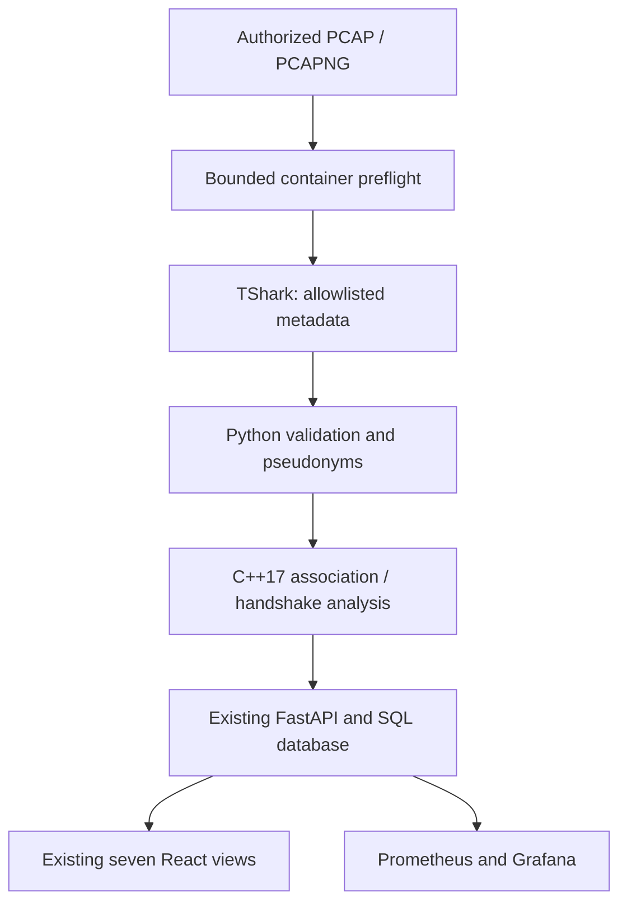

# V3 incremental architecture

V3 extends main `771352a` on `feature/wirelesslab-v3-cisco-validation`. The existing registration APIs, telemetry, database models, SRE pages, monitoring and historical evidence remain. No extra service, framework, database or cloud account is introduced.

| Boundary | Responsibility |
|---|---|
| `capture_format.py` | Strict bounded container headers/blocks, link types, counts, timestamp spans and synthetic checksum match |
| `packets.py` | Maintained TShark protocol decoding, original timestamp retention, allowlisted fields and per-file pseudonyms |
| `schema.py` | Pydantic validation including uint64 replay counters and bounded key-header metadata |
| `analyze.py` | Versioned C++ subprocess bridge, no shell; eight-second timeout per invocation |
| `handshake.cpp` | Per-pair replay-aware session tracking, missing stages, retransmission candidates, chronology and observation-window classification |
| `layers.py` | Simulated client/AP/controller/dashboard observations and evidence-scoped hypotheses |
| `validation.py` | Registered plans and expected-versus-observed assertions; original A–J reused |
| `wireless_api.py` | Existing guest ownership and SQL run storage, new consent-bound imports and validation reports |
| `WirelessV3.tsx` | Small panels in existing sections; import, handshake, controller and plan details |

Raw files are temporary and never stored as database blobs. Saved normalized metadata and results reuse owner-scoped `wireless_runs`, twenty retained runs per session, one-hour session expiry and logout deletion. Expired data is physically removed lazily on later admission. No real Cisco protocol or cloud controller is contacted.

## Compatible contracts

Original `/runs`, `/uploads`, cookie, AP and export contracts remain. `/uploads` is still local-operator-only. New `/imports` accepts a raw binary body, `X-File-Name`, `X-Wireless-Demo: 1`, and explicit `X-Lab-Authorized: true` consent under the existing guest cookie. This is a new file-import capability, not a privilege to run host commands. GET `/plans`, POST `/validations` with `{}` (all cases) or `{ "test_id": "P01" }`, and GET `/runs/{id}/validation-export?format=json|csv` add plan execution and exports. Ownership is checked before every report read/export; errors use existing structured `detail` responses. The one-click guest entry remains.

Normalized event schema adds optional `authenticator`, `replay_counter` as a decimal string (preserves full uint64 precision), `key_info` and `descriptor_type`; old fields/defaults remain. The original C++ ten-column TSV parser accepts the optional three-column suffix replay_counter, key_info, descriptor_type. Association analysis keeps radio AP unknown for Ethernet; the separate handshake bridge uses the observed authenticator role. Main JSON v1 association fields remain unchanged. The dedicated `--handshakes` mode emits its own v1 session contract and never consumes nonce, MIC or key bytes.

## C++ engineering

The original analyzer was retained because its value-owned STL/RAII model and deterministic sorting remain adequate for association state. New handshake state is separate, uses const input iteration and value-owned sessions, checks bounds and emits only validated identifiers. Sort cost is O(n log n). A map indexes client/authenticator pairs; active matching scans at most 64 attempts per pair, expiring candidates by window. The scan is O(n × k), k<=64, plus output work. More active attempts for one pair are rejected, not silently merged. Input is <=50,000 records, while imports are <=5,000 packets. C++ warnings are errors on the shared engine. Tests also exercise 10,000 events across 2,500 clients and full uint64 boundaries.

The CLI is synchronous, not a threaded engine. AddressSanitizer and UBSan were executed with leak detection disabled; no ThreadSanitizer, MSVC or physical radio claim is made. Python subprocess output limits are checked after process completion; these are bounds, not an OS memory sandbox.
