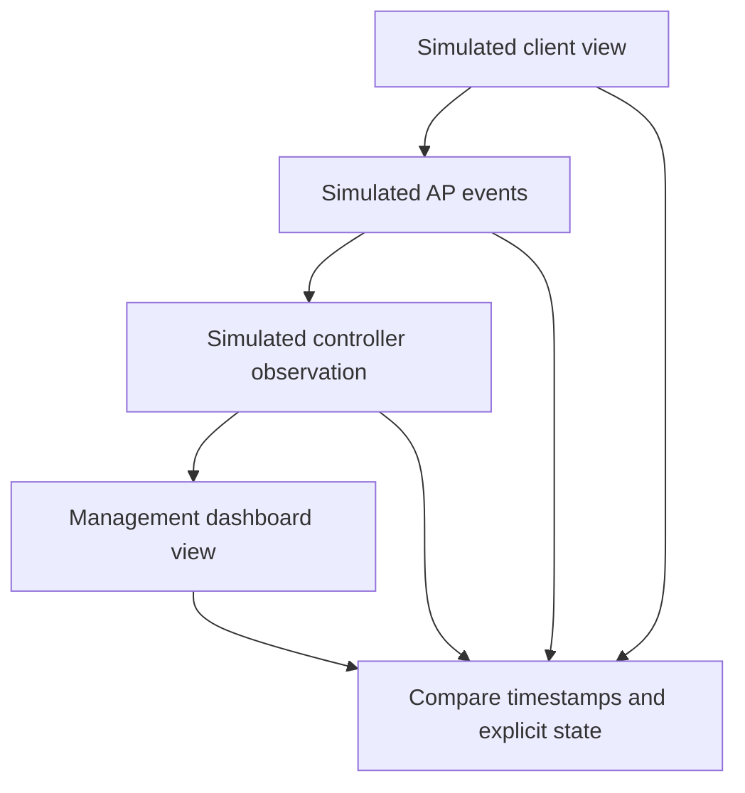

# Simulated cross-layer observations

The original A–J cases remain. C01 adds delayed consistent controller state, C02 adds AP/client disconnect with stale connected controller/dashboard state, C03 preserves missing controller evidence, and C04 exposes explicit client/AP mismatch. Authentication rejection, association rejection, DHCP and DNS failure, duplicate/order handling and incomplete evidence reuse the original cases.

`client_update` and `dashboard_update` are explicit event kinds using `reported_state`; they do not come from a real device protocol. AP acceptance/disconnect sets AP state; controller and dashboard fields stay unknown until their own events exist. The timeline identifies each layer, timestamp and event reference. A result may be CONSISTENT_OBSERVATIONS, CONTROLLER_UPDATE_DELAY, STALE_OR_INCONSISTENT_CONTROLLER, CLIENT_AP_MISMATCH or MISSING_MANAGEMENT_EVIDENCE. Missing management context is not a transport or device failure diagnosis. Classifications describe the available latest views for a client/AP pair, not a complete distributed controller algorithm.

Every hypothesis links back to event references and explicitly assumes a shared clock. RF loss, DHCP infrastructure, sync transport failure, vendor bugs, retries, CAPWAP, real wireless LAN controllers and cloud-management integration are not independently established. Inventory APs remain database-only simulation; registration changes no device.
