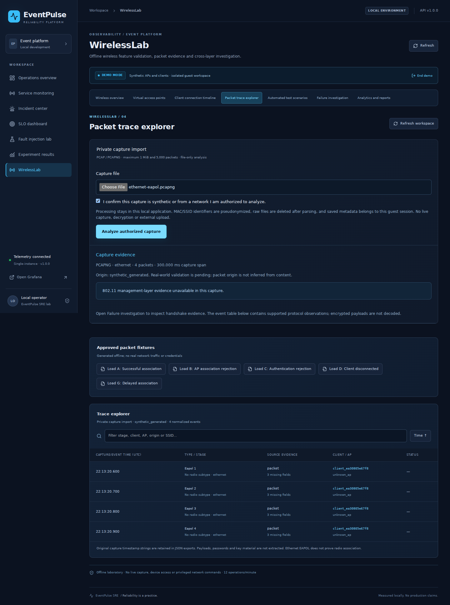
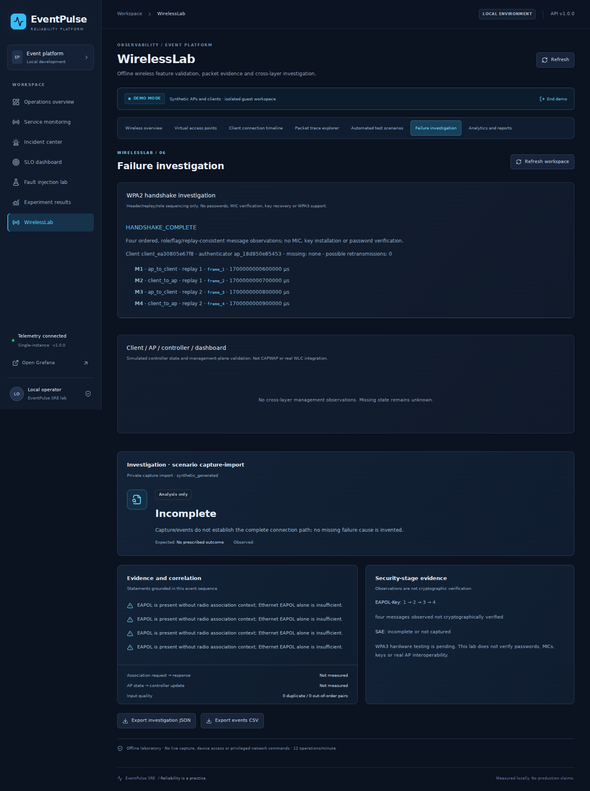
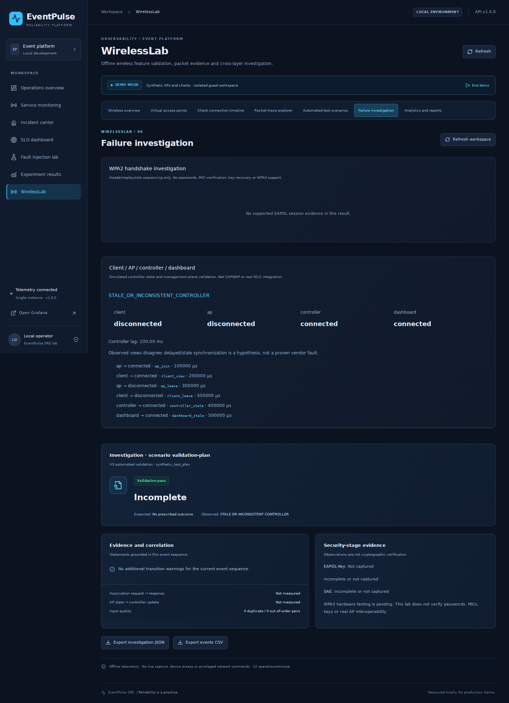
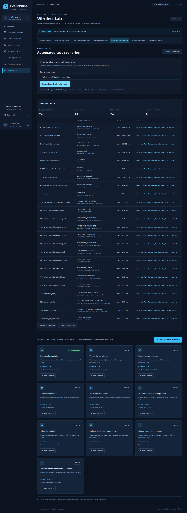
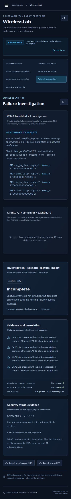

# V3 actual verification

All wireless evidence is synthetic. The complete source/audit starts at main `771352a`; historical initial-release evidence remains unchanged. Fresh baseline results are in BASELINE_AUDIT.md.

| Executed local check | Passed | Failed | Skipped | Environment / report |
|---|---:|---:|---:|---|
| Release CTest | 39 | 0 | 0 | Linux GCC 13.3; `evidence/v3/cpp-junit.xml` |
| AddressSanitizer + UBSan CTest | 39 | 0 | 0 | Debug, `ASAN_OPTIONS=detect_leaks=0`; `sanitizer-junit.xml` |
| Python/API regression + V3 | 132 | 0 | 1 | Python 3.12 / SQLite; native PostgreSQL unavailable locally; `python-api-junit.xml` |
| React/Vitest | 6 | 0 | 0 | Node 24; `frontend-output.txt` |
| TypeScript / Vite production build | pass | 0 | 0 | `frontend-build.txt` |
| Real browser flows | 6 | 0 | 0 | Chromium against live Uvicorn + Vite; `browser-junit.xml` |
| Registered V3 plan | 24 runs | 0 | 0 | 24 unique definitions, `plan-results.json` |
| Deterministic regression replay | 24 runs | 0 | 0 | Same 24 definitions, stable outputs match; `replay-results.json` |
| Held-out synthetic metadata | 120 | 0 mismatches | 0 | Seed 73129; `heldout-results.json`, exact inputs and SHA256 |

All reports above live under [`wireless-lab/evidence/v3`](../../wireless-lab/evidence/v3/). CTest sanitizer repetitions are the same 39 cases, not 78 unique tests. Two recorded plan executions cover 24 unique scenarios, 48 executed runs, 48 passing runs and zero validation failures. Additional API/browser tests and performance repetitions execute plans too; the dashboard counts the current report's executions separately from retained guest history. The 120 held-out cases are distinct synthetic evaluation inputs, not 120 hardware scenarios or a field-accuracy estimate. See TEST_PLAN.md for the exact 10+10+4 catalog and WPA2_HANDSHAKE.md for classification limits.

Baseline historical CI had 84 Python/API tests including PostgreSQL. Local V3 has 133 collected (132 pass + one skip); CI supplies PostgreSQL and is expected to remove that skip, but expected outcomes are not reported as actual results until a real run completes. Local Docker is unavailable. The real PR/CI status and source SHA are recorded in the final PR and a V3 CI verification ledger after execution; no configured stage is claimed to have run just because it exists.

## What was exercised

Parser negatives cover size, extension, traversal, magic/version, truncated record/header/block, invalid trailer/interface, unsupported link layer, excessive packets, nanosecond precision, empty containers and rejected secret blocks. Existing safe subprocess timeout checks remain, and the handshake bridge checks bounded shell-free execution. API tests cover consent/session requirements, raw size enforcement, ownership of imported runs/exports, rejected operator upload, quota denial and all 24 registered outcomes. Frontend tests check consent gating, replay/missing-stage display and registered plan submission. Browser flows retain both original SRE and both original wireless flows, adding real PCAPNG import/JSON export, missing management evidence, WPA2 timeline, controller mismatch, full-plan counts, CSV link and mobile layout.

A browser instrumentation issue initially prevented reading an upload response body from Chromium's inspector cache; the test now reads the owned saved result through the API after checking the real upload status. No application response was faked. Visual QA also waited for the existing mobile sidebar transition and removed an undefined fixture label for imported reports.

## Dependency review

The actual full pinned backend scan found no known advisories. Production npm audit found zero. Full npm audit reports seven development-only Tailwind chain advisories: five high and two moderate, no critical. These are unresolved baseline tool-chain issues, documented rather than hidden; the existing non-blocking CI development-scan report is preserved. No new runtime framework/dependency was added. JSON reports are stored alongside test evidence.

## Running-application screenshots

All screenshots are from executed browser flows using synthetic files and masked imports. No genuine capture or private network identifier is pictured.
